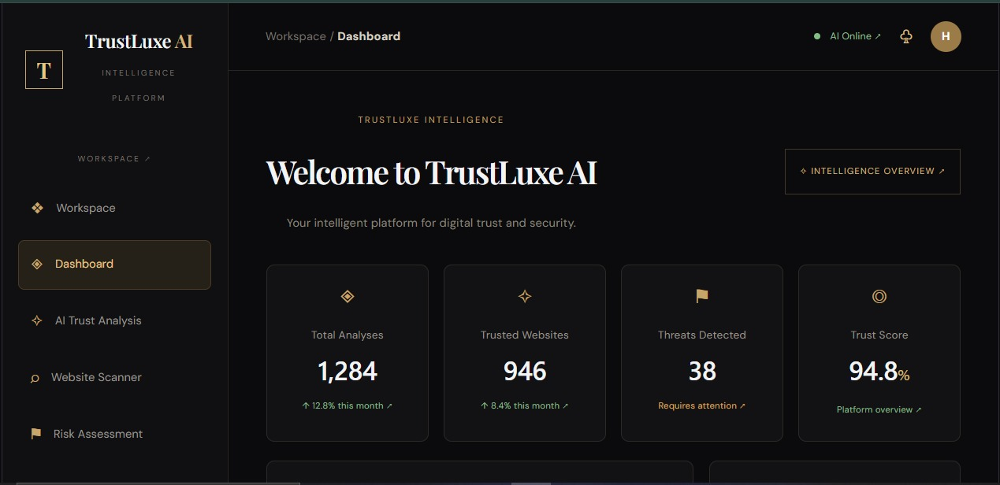
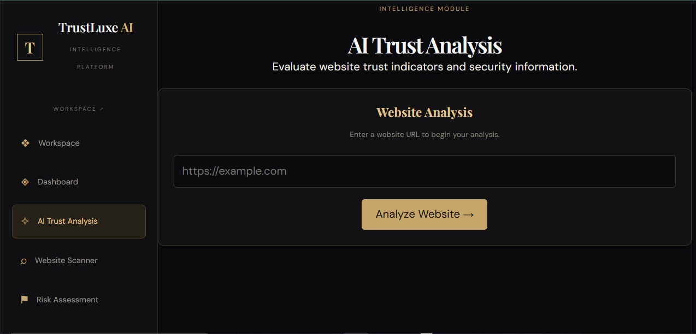
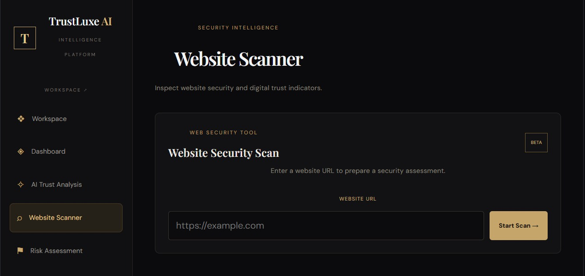
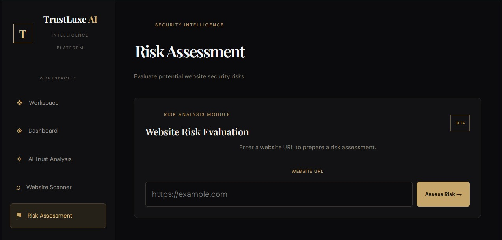
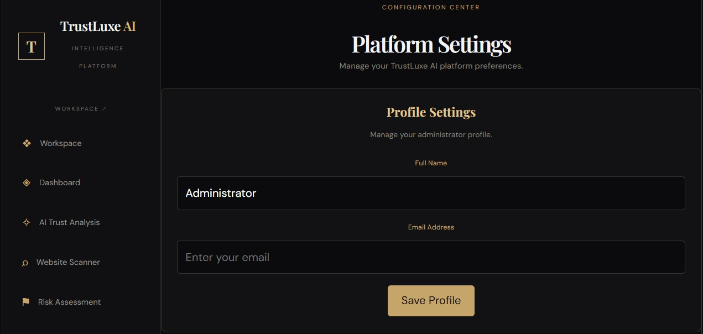

<div align="center">

# 🛡️ TrustLuxe AI
### Intelligent Website Security, Digital Trust & Risk Assessment Platform


**TrustLuxe AI** is a full-stack cybersecurity and digital trust intelligence platform designed to inspect websites, detect security gaps, calculate real-time risk scores, and maintain live audit reports.

[🔍 View KaneAI Verification Report](https://lambdatest.com)

</div>

---

## ✨ Key Modules & Features

| Module | Description |
| :--- | :--- |
| **❖ Workspace Hub** | Dedicated multi-window environment launcher for all security and trust modules. |
| **◈ Intelligence Dashboard** | Centralized command center featuring quick Website Trust Scanner, platform metrics, and live status indicators. |
| **✧ AI Trust Analysis** | Evaluates domain authenticity, SSL/TLS encryption, and computes an AI-driven Trust Score (`0–100`). |
| **⌕ Website Scanner** | Deep-inspects target URLs for protocol security, SSL validity, and real-time threat classification. |
| **⚑ Risk Assessment** | Calculates quantitative Risk Scores (`Low` / `High`), counts security findings, and generates actionable remediation steps. |
| **▤ Live Audit Reports** | Automatically records every scan across all modules into a live, refreshable backend audit log. |

---

## 📸 Platform Preview

### 1. Intelligence Dashboard & Overview


### 2. AI Trust Analysis & Website Scanner


### 3. Risk Assessment & Security Recommendations


### 4. Live Security & Trust Reports


### 5. Workspace & Account Settings


---

## 🧪 End-to-End Verification with Kane CLI

This application has been verified end-to-end using **Kane CLI (TestMu AI)** across real browser workflows:
- **Test Case Dashboard & Execution Replay:** [Open KaneAI Test Manager Report](https://lambdatest.com)


---

## 🏗️ System Architecture

```text
TrustLuxe-AI/
├── src/
│   ├── App.jsx               # Multi-window Workspace, Dashboard & Live Reports
│   ├── WebsiteScanner.jsx    # Deep URL & SSL/TLS security scanner
│   ├── RiskAssessment.jsx    # Risk scoring & security recommendations engine
│   ├── Settings.jsx          # Platform & workspace preferences
│   └── App.css               # Luxury dark-gold cybersecurity UI theme
├── server.js                 # Express 5 REST API & static production server
├── package.json              # Full-stack scripts & dependencies
└── README.md                 # Project documentation & verification proof
```

---

## 🚀 Quick Start (Local Setup)

```bash
# 1. Clone the repository
git clone https://github.com
cd TrustLuxe-AI

# 2. Install dependencies
npm install

# 3. Build the React production bundle
npm run build

# 4. Start the full-stack server
npm start
```
Open **`http://localhost:5000`** in your browser to explore the live platform.
